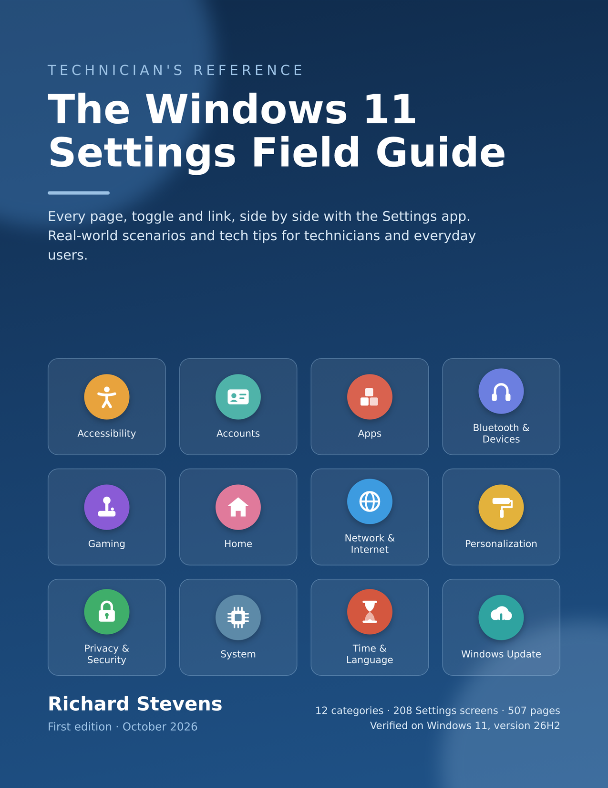

# The Windows 11 Settings Field Guide

**Every page, toggle and link in the Windows 11 Settings app, side by side with the real thing.**
Real-world scenarios and tech tips for technicians and everyday users.

**[⬇ Download the PDF (latest release)](../../releases/latest)**

---

## What it is

Windows 11 has hundreds of settings spread across more than 200 screens in the Settings app. This guide documents all of them in one place, in plain language.

It is built to be used **side by side with Windows Settings**. Open the PDF on one half of the screen and Settings on the other: every row in the guide matches something you can see, in the same order and with the same wording, so you always know what each control does and whether you have found everything on the page.

## What's inside

- **All 12 categories**, from Accessibility to Windows Update: **208 Settings screens across 507 pages**
- **Checked against a real PC.** Every toggle, dropdown, button and link was recorded from screenshots of Windows 11 Pro, not written from memory. On-screen wording is quoted exactly.
- **The exact path to every screen**, for example *Settings → Privacy & security → Camera*
- **A scenario for every setting**: what it is for, and a real situation where you would need it
- **A Tech tip on every page**: shortcuts, common mistakes, and what to check first
- **Clickable contents, PDF bookmarks and a full index** of about 1,350 terms

## Why the scenarios matter

People rarely ask "where is the Filter keys setting?" They say *"my keyboard stopped working,"* *"my screen zoomed in by itself,"* or *"my laptop shuts off when I close the lid."* The scenarios connect those everyday problems to the setting that fixes them.

**For technicians:** get from a customer's complaint to the right setting in seconds, spot settings that get changed by accident, and recognize when a problem comes from a policy, a permission or a hardware limit. Useful alongside CompTIA A+ study.

**For everyday users:** no jargon or prior experience needed. Learn what a setting does before you change it, and fix common annoyances yourself.

## Sections

| | | |
|---|---|---|
| Accessibility | Gaming | Privacy & Security |
| Accounts | Home | System |
| Apps | Network & Internet | Time & Language |
| Bluetooth & Devices | Personalization | Windows Update |

## Version

Captured on **Windows 11 Pro, version 26H2, OS build 26300.9711**. The laptop Power & battery pages were captured on version 25H2, OS build 26200.8973. Settings can change with Windows updates and can differ between devices, editions and versions.

## Feedback

Found a setting that has changed, or a mistake? Please [open an issue](../../issues) with the screen name and, if you can, a screenshot.

## Copyright

© 2026 Richard Stevens. All rights reserved.

You are welcome to download and read this guide. No part of it may be reproduced, redistributed or posted elsewhere without the author's written permission.

Microsoft, Windows, Windows 11 and other Microsoft product names are trademarks of the Microsoft group of companies. This guide is an independent publication and is not affiliated with, sponsored by, or endorsed by Microsoft Corporation.
